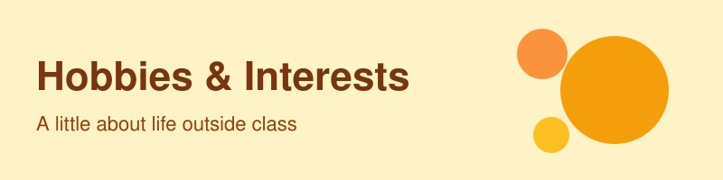

[Home](index.html) | [About me](about.html)

# About Me

Hi! I'm **Samuel Purnama**, a CS student at UW. Outside of class, I'm usually *building something new* or *[your favorite thing to do]*.

## My hobbies

- **Building side projects** – like *Bilby Notes*, a note editor with real-time sync and AI features built on a knowledge graph.
- **Helping student builders** – through CSEED, I helped run programs where students launched their own tech projects.
- **[Hobby 3]** – [one sentence about it]
- **[Hobby 4]** – [one sentence about it]

## A few of my favorites

| Category | Favorite | Why |
|----------|----------|-----|
| Food | [Your favorite food] | [Short reason] |
| Book or show | [Title] | [Short reason] |
| Place | [City or spot] | [Short reason] |
| Music | [Artist or genre] | [Short reason] |

## Community

I'm part of **PERMIAS Seattle**, a community of Indonesian students. I led a team that built the ordering and payment system for its *food festival*, which handled **500** people ordering at the same time.

## Family and home

I grew up in *[hometown]*. My family **[something you'd like to share]**.

### Fun fact

[One fun fact about you.]

## Learn more

Check out my [GitHub profile](https://github.com/SamuelPurnama) or go back to my [academic homepage](index.html).
